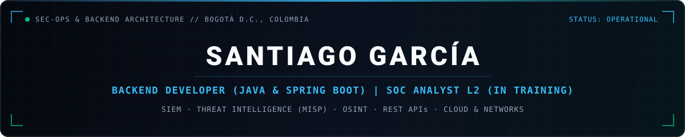

  

  
  
  

 

### ⚡ Perfil Operativo

Desarrollo **arquitecturas backend robustas y seguras** con Java y Spring Boot, integrando buenas prácticas de control de acceso, cifrado y despliegue en contenedores. Paralelamente, me formo como **Analista SOC Nivel 2** y **Tecnólogo en Gestión de Redes de Datos (SENA)**, combinando el desarrollo de software con monitoreo SIEM, inteligencia de amenazas y reconocimiento OSINT sobre entornos Linux.

<table>
  <tr>
    <td width="50%" valign="top">
      <h4>🛡️ Ciberseguridad &amp; Operaciones SOC</h4>
      <ul>
        <li><b>Monitoreo &amp; SIEM:</b> Desarrollo y operación de <i>NOVA SIEM</i> para ingesta de logs, correlación de eventos y gestión de incidentes.</li>
        <li><b>Threat Intelligence:</b> Despliegue, hardening y gestión de indicadores de compromiso (IoCs) en plataformas <b>MISP</b>.</li>
        <li><b>Reconocimiento &amp; Labs:</b> Enumeración DNS/OSINT con <i>theHarvester</i> y <i>Shodan</i>; laboratorios ofensivos/defensivos en <b>TryHackMe</b> y <b>Kali Linux</b>.</li>
      </ul>
    </td>
    <td width="50%" valign="top">
      <h4>⚙️ Ingeniería Backend &amp; Cloud</h4>
      <ul>
        <li><b>APIs &amp; Seguridad:</b> Diseño de servicios RESTful modulares en <b>Java (17/21)</b> y <b>Spring Boot</b> protegidos con <b>Spring Security</b> y <b>JWT</b>.</li>
        <li><b>Persistencia &amp; Datos:</b> Modelado relacional y NoSQL en <b>PostgreSQL</b>, <b>MySQL</b>, <b>Supabase</b> y <b>MongoDB Atlas</b>.</li>
        <li><b>Despliegue &amp; Contenedores:</b> Empaquetado con <b>Docker</b> y despliegue continuo en la nube mediante <b>Render</b> y <b>Netlify</b>.</li>
      </ul>
    </td>
  </tr>
</table>

---

### 🛠️ Stack Tecnológico &amp; Herramientas

#### 🔐 Ciberseguridad, Inteligencia de Amenazas &amp; Redes

  
  
  
  
  
  
  

#### 💻 Lenguajes, Frameworks &amp; Testing de APIs

  
  
  
  
  
  
  
  

#### 🗄️ Bases de Datos, Cloud &amp; DevOps

  
  
  
  
  
  
  
  

#### 🖥️ Sistemas Operativos, Virtualización &amp; Entornos

  
  
  
  
  

---

### 🚀 Arquitectura &amp; Proyectos Destacados

| Proyecto | Arquitectura &amp; Impacto | Tecnologías Clave | Despliegue / Repo |
| :--- | :--- | :--- | :--- |
| **🛡️ NOVA SIEM** | Plataforma SOC para ingesta de eventos de seguridad, análisis de grafos, gestión de incidentes y autenticación segura con JWT. | `Java 21` · `Spring Boot` · `Spring Security` · `PostgreSQL` | [API en Vivo](https://backend-siem.onrender.com) |
| **🔒 Safe for People** | Plataforma de seguridad y rastreo GPS con implementación de protocolos de cifrado y autenticación robusta. | `Java` · `Spring Boot` · `Criptografía` · `Render` | [Repositorio](https://github.com/iTzJulians/Safety-for-people-backend) · [Demo](https://safety-for-people-backend.onrender.com) |
| **🏕️ Crumbe-Camp** | Sistema centralizado de reservas con control de acceso basado en roles (RBAC), gestión de concurrencia y persistencia cloud. | `Spring Boot` · `PostgreSQL` · `Supabase` · `Docker` | [Repositorio](https://github.com/dargarciacol/Base-de-datos-Crumbe-Camp) · [Demo](https://base-de-datos-crumbe-camp.onrender.com/) |
| **📋 Task Planner API** | API RESTful con validación estricta de DTOs, arquitectura en capas y documentación interactiva OpenAPI. | `Java` · `Spring Boot` · `Swagger / OpenAPI` · `PostgreSQL` | [Repositorio](https://github.com/dargarciacol/backend--planificador-de-tareas) · [Swagger UI](https://backend-planificador-de-tareas.onrender.com/swagger-ui/index.html) |

---

### 📊 Métricas &amp; Actividad en GitHub

  
  

  

